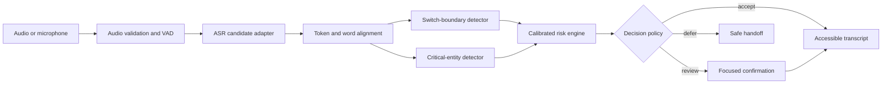

# SwitchSure Voice

Uncertainty-aware multilingual speech recognition that protects critical entities at language-switch boundaries.

SwitchSure Voice is a research-to-product platform for multilingual voice accessibility. Its first research lane is Tamil-English code-switching; the architecture remains language-pair agnostic.

## Research question

> Can speech models detect uncertainty around language switching and preserve critical entities in multilingual voice tasks?

The project treats that as an empirical question. A release must demonstrate all of the following on speaker-disjoint test data:

1. calibrated word- and boundary-level uncertainty;
2. improved critical-entity preservation without unacceptable general-ASR regression;
3. a useful risk-coverage trade-off when the system asks for confirmation;
4. comparable performance across declared speaker and acoustic subgroups.

## Product promise

The interface does not silently turn low-confidence speech into high-confidence text. It shows what it heard, marks uncertain spans, preserves critical entities, and asks the user to confirm only when the expected harm justifies interruption.

## Architecture at a glance



The detailed design is in [docs/architecture/system-design.md](docs/architecture/system-design.md). The measurable research contract is in [docs/research/evaluation-contract.md](docs/research/evaluation-contract.md), and the advanced mathematical approach is in [docs/research/mathematical-methods.md](docs/research/mathematical-methods.md).

## Repository layout

```text
apps/
  api/                 FastAPI delivery layer
  web/                 Accessible browser client
packages/
  switchsure-core/     Domain models, policies, ports, and orchestration
  switchsure-ml/       ASR, language-ID, entity, and calibration adapters
  switchsure-eval/     Reproducible evaluation and reporting
docs/                  Product, architecture, research, security, and ADRs
configs/               Preregistered, machine-readable experiment contracts
.agents/skills/         Repository-local agent skills
```

## Current phase

Phase 0 is complete. Phase 1 engineering now includes a fail-closed, privacy-safe Whisper benchmark
runner in addition to immutable manifests, leakage rejection, model-neutral adapters, normalization,
bootstrap intervals, and release gates. Common Voice 27 Tamil and English are approved only as real
monolingual controls; no natural Tamil-English corpus has yet passed the full access/consent and
annotation review. Therefore no real zero-shot score is claimed. See the
[execution record](docs/research/phase1-whisper-execution.md) and
[dataset decisions](docs/data/dataset-inventory.md).

Phase 2 engineering adds train-only boundary/error heads, calibration-only temperature scaling,
matched non-boundary controls, and a declared boundary-aware ablation. Phase 3 engineering adds
Tamil-English structured-entity recognition, reversible canonicalization, and a time-aligned
candidate lattice that routes competing values to review. Both phases still require the approved
real-speech study before any performance claim. See the
[Phase 2 plan](docs/research/phase2-boundary-aware-plan.md),
[Phase 3 contract](docs/research/phase3-critical-entity-preservation.md), and
[roadmap](docs/roadmap.md).

Phase 4 engineering now has a bounded asynchronous job lifecycle, content-free durable SQLite
metadata, ephemeral payload/result retention, capability-scoped anonymous pilot access, worker
leases and timeouts, privacy-safe fixed-cardinality telemetry, and an accessible browser flow for
queueing, polling, cancellation, retry, and typed fallback. This is a pilot foundation, not a
production deployment: the real GPU worker, authenticated accounts, external telemetry export,
full-service load/security testing, and manual WCAG/assistive-technology review remain gated. See
the [pilot API contract](docs/api/pilot-jobs.md),
[observability contract](docs/operations/pilot-observability.md), and
[accessibility status](docs/product/accessibility-status.md).

The current scorer is an intentionally transparent, uncalibrated baseline. It is suitable for architecture and interaction testing, not for medical, financial, or other consequential decisions. Promotion to a real-world pilot is gated by the speaker-disjoint evaluation contract.

## Run the vertical slice

Prerequisites: Python 3.12+, [uv](https://docs.astral.sh/uv/), and Node.js 24+.

```powershell
uv sync --all-packages --locked
uv run uvicorn switchsure_api.main:app --reload
```

In a second terminal:

```powershell
Set-Location apps/web
npm ci
npm run dev
```

Open `http://127.0.0.1:5173`. The web client calls the API at `http://127.0.0.1:8000` by default; set `VITE_API_BASE_URL` to override it.

## Verify the repository

```powershell
uv run ruff check .
uv run ruff format --check .
uv run mypy .
uv run pytest --cov --cov-report=term-missing

Set-Location apps/web
npm run typecheck
npm test
npm run build
```

GitHub Actions runs the same Python and web quality gates for every pull request and push to `main`.
