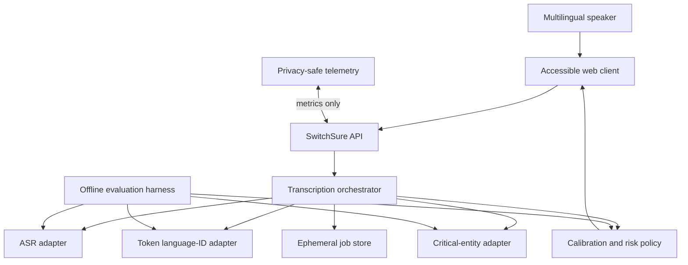
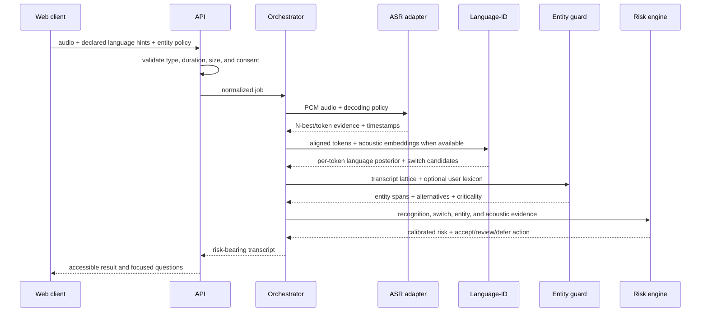
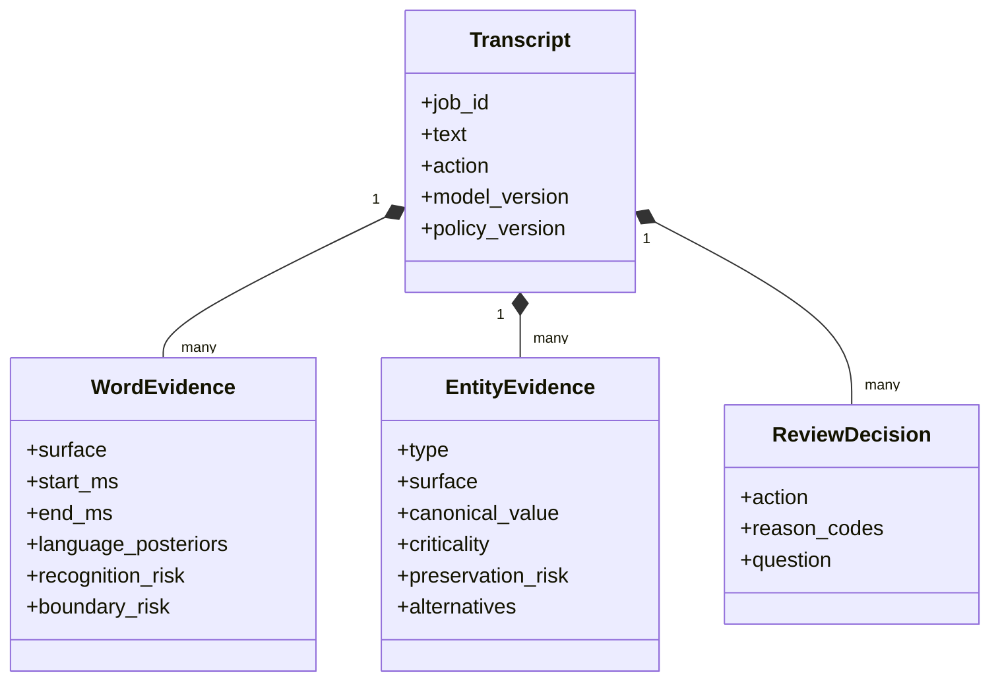

# System design

## 1. Design objective

Build a model-agnostic platform that turns audio into a **risk-bearing transcript** rather than a plain string. Every output span carries enough evidence for calibration, review, evaluation, and audit without retaining the source audio indefinitely.

The first implementation is a modular monolith. The boundaries are deliberately shaped so compute-heavy inference can move to separate workers later without changing product contracts.

## 2. First-principles decomposition

The research question contains three distinct problems:

1. **Recognition:** what word or subword was spoken?
2. **Switch awareness:** where did the active language change, and how uncertain is that decision?
3. **Consequence awareness:** which recognition errors matter enough to interrupt the user?

A single confidence number cannot answer all three. SwitchSure therefore maintains separate evidence for recognition confidence, language posterior, boundary risk, entity criticality, candidate disagreement, and acoustic quality. A calibrated policy combines them only at the final decision boundary.

## 3. Context diagram

## 4. Online pipeline

## 5. Components and contracts

### 5.1 Audio gateway

- Accept only explicitly supported media types and bounded duration/size.
- Decode to mono 16 kHz PCM behind an adapter.
- Run voice activity detection without destroying original timestamps.
- Record signal-quality features such as speech duration, clipping, signal-to-noise proxy, and silence ratio.
- Delete raw uploads after inference unless the user explicitly opts into research donation.

### 5.2 ASR candidate adapter

The port returns a model-neutral `RecognitionEvidence` object:

- word/token surface form and normalized form;
- start/end time;
- token log probabilities where available;
- N-best alternatives or repeated-decoding candidates;
- segment language probabilities;
- decoder and model provenance.

The initial practical adapter is faster-whisper because it exposes word timestamps, VAD integration, language probabilities, multilingual per-segment detection, and hotword hints. A Hugging Face Whisper adapter remains the research path when full generation scores and hidden states are required. SeamlessM4T is an optional comparison adapter, not an unverified default.

### 5.3 Token language identification and boundary detector

The production target is a multi-task speech encoder with an auxiliary token language-ID head and explicit switch-boundary supervision. Until that model is trained, the baseline fuses:

- decoder language-token posterior or segment language posterior;
- text token language-ID;
- script evidence;
- local posterior change and candidate disagreement.

A switch boundary is a distribution over positions, not a hard punctuation mark. Ambiguous tokens such as names can remain language-neutral.

### 5.4 Critical-entity guard

Entity classes are policy-driven. The default high-risk set is:

- person and organization names;
- medication, dosage, and medical condition;
- phone, address, email, account, identifier, and reference number;
- date, time, age, quantity, percentage, and currency amount;
- emergency or negation terms when configured by domain.

The entity guard consumes the candidate lattice, not only the top transcript. It combines deterministic recognizers for structured values, a multilingual span model for open entities, optional user/domain lexicons, phonetic similarity, and acoustic/decoder alternatives.

An entity span is immutable evidence. Normalization creates a linked canonical value; it never overwrites the spoken surface form.

### 5.5 Calibration and risk engine

Raw neural softmax scores are commonly overconfident. The risk engine is fitted on a held-out calibration split and versioned separately from the ASR model.

Baseline evidence features:

- token negative log-likelihood and entropy;
- top-1/top-2 margin;
- N-best or repeated-decoding disagreement;
- word duration and timestamp stability;
- language-posterior entropy and change near the word;
- distance from a predicted switch boundary;
- entity type and entity-model score;
- acoustic quality features;
- hotword/lexicon match evidence.

The first calibrator is an interpretable logistic or gradient-boosted word-correctness model followed by held-out isotonic or temperature calibration. The research track compares learned confidence estimators and group-aware or pair-aware calibration. Conformal prediction sets may be added only after verifying exchangeability assumptions for the intended deployment slices.

### 5.6 Decision policy

The policy maps calibrated risk and criticality to:

- `accept`: display normally;
- `review`: highlight the smallest meaningful span and offer alternatives;
- `defer`: ask the user to repeat, type, or hand off.

Thresholds are chosen by expected harm and risk-coverage curves, not a universal `0.5` cutoff. The policy is versioned and auditable.

### 5.7 Accessible web client

- Provide record, upload, and text-entry paths.
- Announce recording and processing state through polite live regions.
- Never rely on color alone for risk; use labels, icons, and text.
- Keep word-level highlighting keyboard navigable but avoid flooding screen readers with token details.
- Use a focused review queue for critical entities.
- Offer undo and preserve the user's selected correction.
- Meet WCAG 2.2 AA as the release baseline; track relevant WCAG 3 drafts without claiming conformance to a draft.

## 6. Domain model

## 7. Deployment evolution

### Phase A: research workstation

One API process, local model adapters, SQLite or in-memory job state, and no raw-audio persistence.

### Phase B: controlled pilot

Static web client, API service, GPU inference worker, Redis-compatible queue, PostgreSQL metadata, object storage with explicit retention, OpenTelemetry, and encrypted secrets.

### Phase C: scale

Autoscaled inference pools by model/hardware, streaming gateway, regional data boundaries, shadow evaluation, canary policies, and model registry. These are earned by load and compliance requirements; they are not premature microservices.

## 8. Reliability and observability

- Propagate a random request ID; never derive it from user content.
- Emit stage latency, queue delay, model version, policy version, action counts, error class, and coarse language pair.
- Do not put audio, transcript text, entities, access tokens, or file names into logs.
- Bound every external/model call with a timeout and cancellation path.
- Return typed failure states: invalid audio, unsupported language, model unavailable, low evidence, and internal error.
- Prefer a safe retry or typed-input fallback over fabricated transcript content.

## 9. Security and privacy

See [../security/threat-model.md](../security/threat-model.md). Core controls are data minimization, explicit consent, content-free logging, bounded uploads, sandboxed media decoding, dependency pinning, encrypted transport/storage, and deletion verification.

## 10. Key decisions

- [ADR-0001: Python-first modular monolith](../adr/0001-python-first-modular-monolith.md)
- [ADR-0002: Risk-bearing transcript contract](../adr/0002-risk-bearing-transcript.md)
- [ADR-0003: Calibrate before user-facing confidence](../adr/0003-calibrated-selective-prediction.md)

The formal objectives, uncertainty decomposition, entity lattice, selective-prediction policy, conformal option, and budgeted inference cascade are specified in [mathematical methods](../research/mathematical-methods.md).
